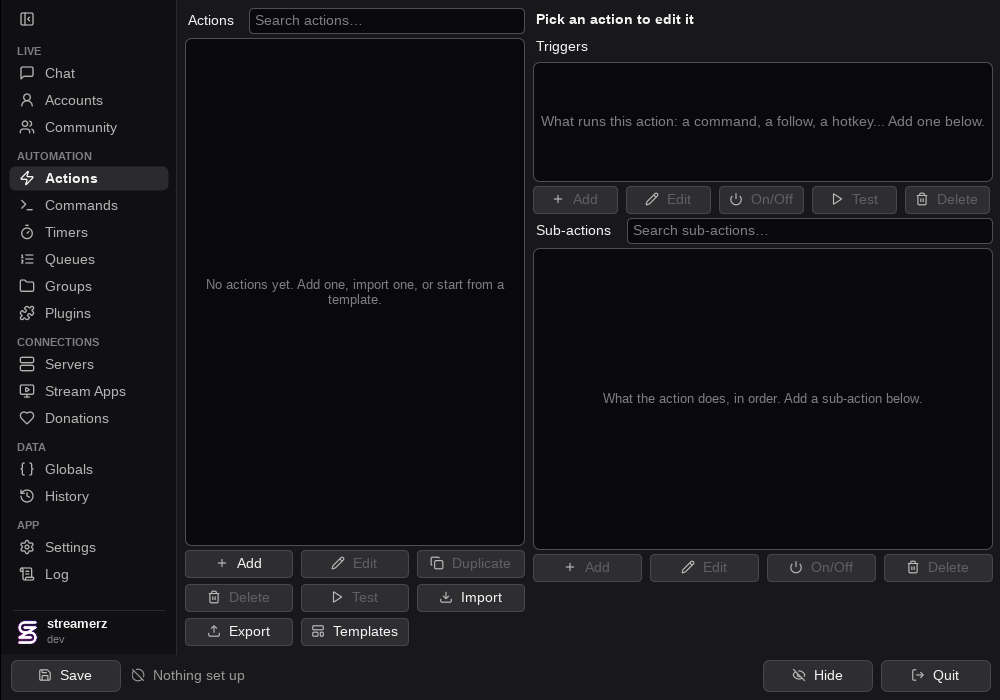
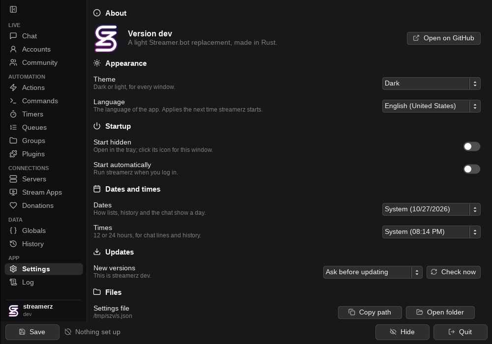

  <picture>
    <source media="(prefers-color-scheme: dark)" srcset="assets/brand/streamerz-dark.svg">
    
  </picture>

<h1 align="center">Streamerz</h1>

  A light, fast Streamer.bot replacement in Rust. 
  Twitch, Kick, YouTube and TikTok chat, OBS Studio, Streamlabs Desktop, and Streamer.bot's actions,
  triggers and servers, in one small window that lives in your tray.

  
  
  
  
  
  
  
  
  
  

  <a href="#install">Install</a> ·
  <a href="#why">Why</a> ·
  <a href="#languages">Languages</a> ·
  <a href="#contributing">Contributing</a> ·
  <a href="docs/COMMANDS.md">Commands</a> ·
  <a href="docs/INTEGRATIONS.md">Integrations</a> ·
  <a href="PLUGINS.md">Plugins</a> ·
  <a href="SECURITY.md">Security</a>

  
  

## Why

- **Light.** Hidden in the tray with Twitch and OBS connected it stays under 25 MB of RAM and uses no CPU
  while idle. Nothing you don't turn on opens a socket, a timer or a task.
- **Compatible.** The same WebSocket, HTTP and UDP servers, requests, events and import strings as
  Streamer.bot: overlays, Stream Deck and your existing actions work without changes.
- **Everything in one place.** Chat from every platform together, commands, timers, queues, globals,
  donations (StreamElements, Streamlabs, DonorDrive), hotkeys, MIDI, Stream Deck and more.
- **Extensible.** Plugins are WebAssembly files (see [PLUGINS.md](PLUGINS.md)), and an MCP server lets an
  AI assistant build and test actions for you.
- **Private.** Logins live in your system's keyring (DPAPI on Windows), never in plain text. Websites
  can't reach your local servers.
- **Native.** Dark and light themes, many languages, native notifications, and updates that keep
  themselves current.

## Install

Download the latest [release](https://github.com/PedroZamecki/streamerz/releases):

| System | File |
| --- | --- |
| Windows | `Streamerz-windows-x86_64.exe` |
| Linux (any distribution) | `Streamerz-linux-x86_64.AppImage` (`chmod +x`, then run it) |

It starts hidden in the tray: click the icon to open the window. Settings are kept in `streamerz.json`
(and the previous version in `streamerz.json.bak`). **Settings > Updates** chooses what happens with new
versions: ask first (the default), download them in the background and use them at the next start, or
leave them alone. Streamerz looks every hour while it's open and tells you with a desktop notification.

## Where things live

On first run Streamerz asks where to keep its settings, suggesting the folder your system expects
(`%APPDATA%\\streamerz`, `~/.config/streamerz`). The choice is yours; **Settings > Files > Change** moves it
later. Next to the settings file:

- `logs/`: the current log (`latest.log`), the last seven gzipped, and a `crash-*.txt` for every crash.
  A report says what the app was doing (the page, the last things you clicked, your system), so a bug can
  be repeated. The **Crashes** page lists them, and **Backups** keeps a copy of your settings for every
  update.
- If the last run crashed, the next start offers to send the report as a prefilled GitHub issue (you read
  and edit it first; logins are never in it, and your home folder is hidden).

Chat history is never saved: it is read from Twitch, Kick and YouTube when you join, and kept in memory.

## Languages

Streamerz speaks the languages below, picked in **Settings**. Each one is a single file in
`assets/locales`, made by the people listed here. Yours is missing, or a word is off? It takes one file
and no code: see [LOCALIZATION.md](LOCALIZATION.md).

| Language | Code | Translated by |
| --- | --- | --- |
| English (United States) | `en_US` | [Pedro Zamecki](https://github.com/PedroZamecki) |
| Português (Brasil) | `pt_BR` | [Pedro Zamecki](https://github.com/PedroZamecki) |

*Add your language and your row in the same pull request: you get the credit here.*

## Streamer.bot's servers

Streamerz answers on Streamer.bot's WebSocket server (`ws://127.0.0.1:8080/`, on by default), its HTTP
server (port 7474) and its UDP server (port 4242), both off by default, with the same requests, events
and authentication, so tools made for Streamer.bot (songrequestz, overlays, Stream Deck) connect without
changes. Set them in the Servers tab (changes apply at once), along with WebSocket clients and custom
servers.

Unlike Streamer.bot, websites can't reach them: a browser page from another site (which could otherwise
run your actions or chat as your bot) is refused. Apps, local overlays (OBS browser sources with local
files, `localhost`) and the websites you list in Servers > WebSocket > **Websites allowed** get in.

## Your logins

Logins (tokens, cookies) and passwords/secrets you type are never stored as plain text in
`streamerz.json`: on Windows they're encrypted for your Windows user (DPAPI); on Linux with a key kept in
your keyring (GNOME Keyring, KWallet, KeePassXC), which may ask to unlock the first time. Without a
keyring they stay in the file, which only you can read. **Logout** also revokes the login at Twitch, Kick
and Google. Copying `streamerz.json` to another computer or user doesn't carry the logins: log in again.
Importing actions that run programs shows them and asks first.

## The editor

Click the tray icon to open the window. The Actions tab lists your actions by group; select one to see
its triggers and sub-actions. Add, edit, enable/disable and delete them with the buttons; drag an action
onto a group to move it there, and drag sub-actions to reorder them or into a group, If/Else branch or
loop. Double-click anything to edit it. Core sub-actions and triggers open in a form (actions, queues,
timers and commands picked by name; "Edit JSON" shows the whole thing); the others open as JSON.
**Import** takes a Streamer.bot import string (pasted or from a file); **Export** makes one from the
actions you tick, with the commands, timers and queues they use. Sub-actions that don't run in
Streamerz are kept, shown greyed out with "(not supported)", and skipped.

The other tabs, as in Streamer.bot:

- **Chat**: every set-up platform's chat **all together** (tagged TW/YT/KI/TT), **side by side** (one
  column each), or one platform alone (then what you send goes to that platform). Click a name for that
  user's card: roles, messages this session, their variables (%userName%...), and what Twitch or Kick says
  (account age, following since, subscription, their channel). Emoji show as they are, and platform emotes (Twitch, Kick, YouTube's
  own) are highlighted by name. Send at the bottom: **To** a platform or **All connected**, **as bot** (the
  broadcaster when no bot is logged in) or **as broadcaster**, Enter or **Send**. **Emotes** offers emoji
  and the emotes seen in chat; each platform gets its own format (on Kick an emote name becomes Kick's
  emote tag, a Kick emote sent elsewhere becomes its name). A send that fails says why, in grey.
- **Commands** and **Timers**: add, edit (a form), turn on/off and delete them.
  A command can just answer: put the text in **Reply text** (variables like `%user%` and `%input0%`
  work); it answers where it was typed, or everywhere with **Reply on every connected platform**. The
  platform boxes choose where a command works; new ones work everywhere.

## Chat

- Twitch badges as Twitch's own pictures (the ones the chatter wears, as Twitch's chat shows them); other platforms' roles drawn. **Options** hides the time or the badges.
- One view for every set-up platform's chat (together, side by side, or one platform), drawn with the platforms' logos, role badges and name colours. Click a name for what's known about that user.
- Emotes as pictures: Twitch (animated ones too), Kick and YouTube's own, the channel's BTTV, FFZ and 7TV emotes (7TV on Kick too), animated ones moving while the chat is on screen; Unicode emoji as Twemoji pictures.
- An emote picker with the emotes seen in chat, the channel's third-party emotes and every emoji by group. Right click a message to copy it.

## Contributing

Streamerz is made by one person and the people who help. Everything is welcome: a bug report, a better
word in your language, a fix, a feature.

- **Found a bug or want something?** [Open an issue](https://github.com/PedroZamecki/streamerz/issues/new/choose).
  A crash? The Crashes page in Streamerz fills in the report for you.
- **Translate it:** [LOCALIZATION.md](LOCALIZATION.md).
- **Write code:** [CONTRIBUTING.md](CONTRIBUTING.md) has how to build, test and send a pull request;
  [DEVELOPING.md](DEVELOPING.md) has how it works inside; [PLAN.md](PLAN.md) is what comes next.
- **Found a security problem?** Please don't post it: [SECURITY.md](SECURITY.md).

More guides: [Built-in chat commands](docs/COMMANDS.md), [Integrations](docs/INTEGRATIONS.md) (Streamlabs
Desktop, donations, webhooks, hotkeys, MIDI, Stream Deck, files), [Plugins](PLUGINS.md), [what each chat
effect does](CHAT.md).

## Credits

- Platform logos: [Simple Icons](https://simpleicons.org) (CC0 1.0).
- Emoji pictures: [Twemoji](https://github.com/jdecked/twemoji) by Twitter and contributors (CC-BY 4.0), loaded from jsDelivr when shown.
- Emoji list: Unicode's [emoji-test.txt](https://unicode.org/Public/emoji/latest/emoji-test.txt) (Unicode License v3).

## MCP (AI assistants)

`Streamerz --mcp` is a [Model Context Protocol](https://modelcontextprotocol.io) server on stdin/stdout that
drives a running Streamerz through its WebSocket server: status, log, actions, run an action, list and
fire triggers, inject a chat message and read what would have been sent. Start Streamerz with
`STREAMERZ_DEV=1` for the testing tools (it then keeps chat replies instead of sending them). It connects to
the address in `streamerz.json` next to the exe, or `STREAMERZ_URL`.

- Claude Code: `claude mcp add Streamerz -- /path/to/Streamerz --mcp` (this repo's `.mcp.json` points at
  `target/release/Streamerz` and a dev instance on port 8090).
- Other clients: command `/path/to/Streamerz`, argument `--mcp`.
