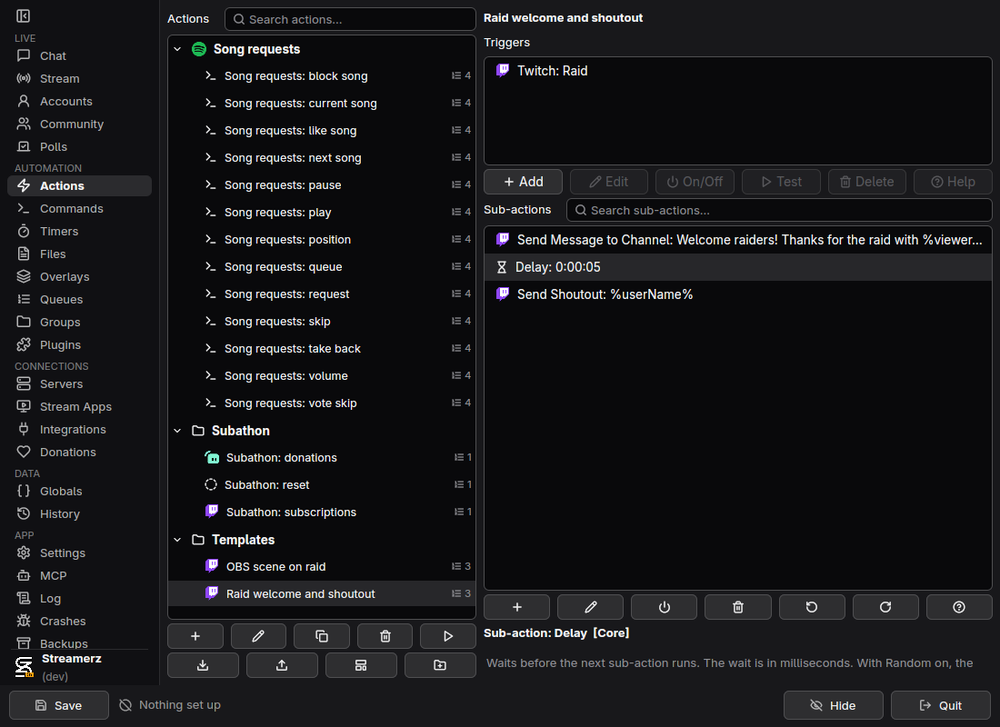
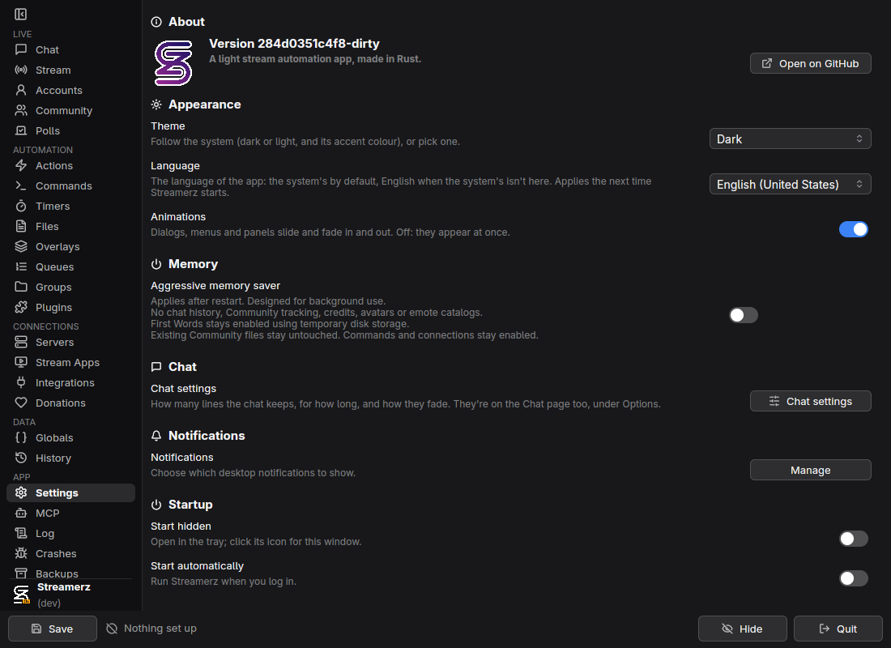

  <picture>
    <source media="(prefers-color-scheme: dark)" srcset="assets/brand/streamerz-dark.svg">
    
  </picture>

<h1 align="center">Streamerz</h1>

  A light, fast stream automation app in Rust. 
  Twitch, Kick, YouTube and TikTok chat, OBS Studio, Streamlabs Desktop, and Streamer.bot's actions,
  triggers and servers, in one small window that lives in your tray.

  
  
  
  
  
  
  
  
  
  

  <a href="#install">Install</a> ·
  <a href="#why">Why</a> ·
  <a href="#languages">Languages</a> ·
  <a href="#contributing">Contributing</a> ·
  <a href="docs/COMMANDS.md">Commands</a> ·
  <a href="docs/INTEGRATIONS.md">Integrations</a> ·
  <a href="PLUGINS.md">Plugins</a> ·
  <a href="SECURITY.md">Security</a>

  
  

## Why

- **Light.** Hidden in the tray with Twitch and OBS connected it stays under 25 MB of RAM and uses no CPU
  while idle. Nothing you don't turn on opens a socket, a timer or a task.
- **Compatible.** The same WebSocket, HTTP and UDP servers, requests, events and import strings as
  Streamer.bot: overlays, Stream Deck and your existing actions work without changes.
- **Everything in one place.** Chat from every platform together, commands, timers, queues, globals,
  donations (StreamElements, Streamlabs, DonorDrive), hotkeys, MIDI, Stream Deck and more.
- **Extensible.** Plugins are WebAssembly files (see [PLUGINS.md](PLUGINS.md)), and an MCP server lets an
  AI assistant build and test actions for you.
- **Private.** Logins live in your system's keyring (DPAPI on Windows), never in plain text. Websites
  can't reach your local servers.
- **Native.** Dark and light themes, many languages, native notifications, and updates that keep
  themselves current.

## Install

Download the latest [release](https://github.com/PedroZamecki/streamerz/releases):

| System | File |
| --- | --- |
| Windows | `Streamerz-windows-x86_64.exe` |
| Linux (any distribution) | `Streamerz-linux-x86_64.AppImage` (`chmod +x`, then run it) |

It starts hidden in the tray: click the icon to open the window. Settings are kept in `streamerz.json`
(and the previous version in `streamerz.json.bak`). **Settings > Updates** chooses what happens with new
versions: ask first (the default), download them in the background and use them at the next start, or
leave them alone. Streamerz looks every hour while it's open and tells you with a desktop notification.

## Where things live

On first run Streamerz asks where to keep its settings, suggesting the folder your system expects
(`%APPDATA%\\streamerz`, `~/.config/streamerz`). The choice is yours; **Settings > Files > Change** moves it
later. Next to the settings file:

- `logs/`: the current log (`latest.log`), the last seven gzipped, and a `crash-*.txt` for every crash.
  A report says what the app was doing (the page, the last things you clicked, your system), so a bug can
  be repeated. The **Crashes** page lists them, and **Backups** keeps a copy of your settings for every
  update.
- If the last run crashed, the next start offers to send the report as a prefilled GitHub issue (you read
  and edit it first; logins are never in it, and your home folder is hidden).

Chat history is never saved: it is read from Twitch, Kick and YouTube when you join, and kept in memory.

## Languages

Streamerz speaks the languages below, picked in **Settings**. Each one is a single file in
`assets/locales`, made by the people listed here. Yours is missing, or a word is off? It takes one file
and no code: see [LOCALIZATION.md](LOCALIZATION.md).

| Language | Code | Translated by | Added in |
| --- | --- | --- | --- |
| English (United States) | `en_US` |  [Pedro Zamecki](https://github.com/PedroZamecki) | [#60](https://github.com/PedroZamecki/streamerz/pull/60) |
| Português (Brasil) | `pt_BR` |  [Pedro Zamecki](https://github.com/PedroZamecki) | [#64](https://github.com/PedroZamecki/streamerz/pull/64) |

*Add your language and your row in the same pull request: you get the credit here.*

## Streamer.bot's servers

Streamerz answers on Streamer.bot's WebSocket server (`ws://127.0.0.1:8080/`, on by default), its HTTP
server (port 7474) and its UDP server (port 4242), both off by default, with the same requests, events
and authentication, so tools made for Streamer.bot (songrequestz, overlays, Stream Deck) connect without
changes. Set them in the Servers tab (changes apply at once), along with WebSocket clients and custom
servers.

Unlike Streamer.bot, websites can't reach them: a browser page from another site (which could otherwise
run your actions or chat as your bot) is refused. Apps, local overlays (OBS browser sources with local
files, `localhost`) and the websites you list in Servers > WebSocket > **Websites allowed** get in.

## Your logins

Logins (tokens, cookies) and passwords/secrets you type are never stored as plain text in
`streamerz.json`: on Windows they're encrypted for your Windows user (DPAPI); on Linux with a key kept in
your keyring (GNOME Keyring, KWallet, KeePassXC), which may ask to unlock the first time. Without a
keyring they stay in the file, which only you can read. **Logout** also revokes the login at Twitch, Kick
and Google. Copying `streamerz.json` to another computer or user doesn't carry the logins: log in again.
Importing actions that run programs shows them and asks first.

## Spotify

Spotify is optional. To connect, you need Spotify Premium and your own Spotify developer app:

1. Create an app in the [Spotify developer dashboard](https://developer.spotify.com/dashboard),
   select Web API and add `http://127.0.0.1:45564/callback` as a redirect URI.
2. In Streamerz, open **Integrations**, then **Advanced** beside Spotify, and enter the app's client ID.
   Add your Spotify account in the app's User Management page if needed.
3. Choose **Connect** and approve access in your browser.

Spotify development-mode apps have account and user limits. See [Spotify's quota mode guide](https://developer.spotify.com/documentation/web-api/concepts/quota-modes)
for the current requirements. Streamerz can read the current track and add a Spotify track link, URI or
song name to your Spotify playback queue through its WebSocket and MCP tools. A song name is searched on
Spotify and the result that best matches the words (title and artist, in any order, with or without a
dash) is used; naming the artist helps. Spotify playback must already be available; Streamerz does not play audio. The queue
request may fail if Spotify has no active device or denies access.

On Windows, **Check local Spotify** can read the title and artist from a local Spotify media session
without an API login. Connect Spotify to use its API actions, including queue and playback controls.
The Spotify player actions also include device selection, seek, shuffle, repeat and recent tracks.
Reconnect Spotify to grant recent listening access if your existing login predates that action.

### Where Spotify is, and what works without the login

Spotify is on **Integrations**: Connect, Disconnect, Advanced (your client ID) and **Monitor local
Spotify**. Everything is in **Integrations > Spotify** when you pick a trigger or sub-action:

- **Triggers**: Connected, Disconnected, Error, Local session connected and disconnected, Track changed,
  Playback started and paused, and the song request ones (requested, refused, taken back, skipped, vote to
  skip, blocked).
- **Sub-actions**: Player (current track, devices, queue, play, pause, next, previous, seek, volume, add to
  queue, transfer playback, shuffle, repeat, playback state, recently played), Song Requests (the request
  itself, take back, skip, vote to skip, block, get and clear requests) and Library (like song).

Spotify is also found **without the login**, from the app on this computer (Windows media session; on Linux
MPRIS). Turn on Monitor local Spotify and Streamerz sees the song that plays and whether it plays: the
Track changed, Playback started and paused and Local session triggers, and Get Current Track. Everything else
needs the login (queue, search, song requests, volume, seek, devices, shuffle, repeat, library): those
sub-actions say so in `spotifyError`, and the page says it too.

### Song requests

Streamerz does what Songify does for Spotify. Choose **Templates**, then **Song requests (Spotify)**. It adds a
group named Song requests, with the Spotify logo as its icon, and one command for Twitch, YouTube and Kick
each:

| Command | What it does |
| --- | --- |
| `!sr song or link` (also `!ssr`) | Adds the best match to your Spotify queue, at once, and replies with the song, its place and when it plays |
| `!song`, `!next` | What plays now, what is next, and who asked |
| `!queue`, `!pos` | The next five songs, and where the viewer's own songs are |
| `!remove` | Takes back the viewer's last request: it is skipped when it starts. A moderator can add `@name` or a number |
| `!skip`, `!voteskip` | Skip (moderators by default; a viewer can skip the song they asked for) and a vote to skip |
| `!play`, `!pause`, `!vol 0-100` | Playback and volume (moderators) |
| `!songlike` | Saves the song that plays to your liked songs (moderators) |
| `!bansong` | Blocks the song that plays for good and skips it (moderators) |

A request can be a name (`firework katy perry`, `firework - katy perry` or `katy perry - firework`), a Spotify
track link or a `spotify:track:` URI. Links to albums, artists, playlists, episodes and short links are
refused with a message. The best of Spotify's first ten results is chosen by the words of the title and the
artist, and a request no result matches is "No track found".

Open **Group settings** to change who can request (everyone, subscribers, VIPs or moderators), songs per
viewer and per subscriber, who has no limit, the longest song, explicit songs (and who may still ask for
them), blocked viewers, artists and songs, who can skip, votes to skip and the wait between skips, who
controls playback, and every reply. A reply can use `%user%`, `%spotifyTitle%`, `%spotifyArtist%`,
`%spotifyPosition%`, `%spotifyTimeToPlay%`, `%spotifyList%`, `%spotifyRequestedBy%`, `%spotifyVotes%`,
`%spotifyVolume%` and `%spotifyError%`. A command's cooldown is on the Commands page.

Spotify cannot take a song out of its queue, so a song that was taken back stays there until it plays and
Streamerz skips it then; it looks at the player every few seconds only while such a song waits. The
requests are kept while Streamerz runs. Spotify Premium is needed, and Spotify open on a device (it can be
paused: Streamerz names the device). Liking songs and the country check need permissions an older login does
not have: choose **Disconnect** and **Connect** again once. Without them, songs are still requested.

**Disconnect** removes the saved login from Streamerz. To revoke Spotify's authorization, remove the
app from your Spotify account's connected apps.

## The editor

Click the tray icon to open the window. The Actions tab lists your actions by group; select one to see
its triggers and sub-actions. Add, edit, enable/disable and delete them with the buttons; drag an action
onto a group to move it there, and drag sub-actions to reorder them or into a group, If/Else branch or
loop. Double-click anything to edit it. Core sub-actions and triggers open in a form (actions, queues,
timers and commands picked by name; "Edit JSON" shows the whole thing); the others open as JSON.
**Import** takes a Streamer.bot import string (pasted or from a file); **Export** makes one from the
actions you tick, with the commands, timers and queues they use. Sub-actions that don't run in
Streamerz are kept, shown greyed out with "(not supported)", and skipped.

## Action groups

An action group holds actions and also what they share: **settings**, **files**, and the **commands and
timers** they use. Select a group (or one of its actions) and choose **Group settings**:

- **Settings** are named values every action in the group reads as `%group.name%`. Each has a label,
  a type (text, whole number, number, on or off, or a time such as `1:30:00` or `1h 30m`), a default
  and an optional description. **Change value** sets it; **Add setting**, **Edit setting** and
  **Delete setting** declare them. Values persist between runs, and a Set Argument named `group.name`
  updates the shared value.
- **Files** travel with the group, such as an overlay. **Save files** writes them to a folder you
  choose and never replaces a file that is there. An `.html` file is an overlay: **Copy URL** gives its
  address for an OBS browser source, and **Save as page** writes a copy that works as a local file.
  See [Overlays](docs/OVERLAYS.md).
- **Commands and timers** lists the ones the group uses, so exporting the group takes them along.

Exporting an action of a group shares the group whole: its settings (with their current values), files,
commands, timers and icon. On import, settings are merged by name: imported values replace matching
names and other existing values stay. This is a Streamerz extension to the export format and
Streamer.bot ignores it.

Use **Add group**, **Rename group** and **Delete group** to manage groups. Renaming keeps everything
the group holds. Deleting a group leaves its actions, commands and timers ungrouped and deletes its
settings, files and icon. Choose **Set group icon** for a PNG or JPEG up to 1 MB; it is embedded in
exports with a SHA-256 digest.

The MCP tools `list_action_groups`, `manage_action_group`, `group_meta`, `set_group_meta`,
`group_variables`, `set_group_variables`, `action_group_icon`, `export_group`, `export_actions`,
`import_actions`, `save_group_files`, `list_templates` and `add_template` do the same. Importing
actions that run programs requires explicit confirmation before setting `allowPrograms`.

### Subathon timer

Choose **Templates**, then **Subathon timer**. It is an ordinary group named Subathon, built from these
tools: three actions that use the Countdown sub-action, and five settings (starting time, maximum
time, time per subscription, time per donation unit and the donation currency). The countdown starts
when it is added, never goes above the maximum, and pauses while Streamerz is closed. It counts Twitch
subscriptions, resubscriptions and individual gifts, and Streamlabs donations in the chosen currency.
Run the **Subathon: reset** action to start it again.

Open **Group settings > Files**, save `subathon.html` and add it as an OBS browser source. It connects
to the local WebSocket server on port 8080; if you use a different address, append
`?server=ws%3A%2F%2F127.0.0.1%3A8090%2F` to the file URL. If server authentication is enabled, add
`password` as a URL query parameter with the URL-encoded password. Keep that URL private.

To make your own, create a group, declare its settings, build the actions with `%group.name%` in their
fields, add any files, and export it for others to import and configure.

## Other tabs

The other tabs, as in Streamer.bot:

- **Chat**: every set-up platform's chat **all together** (tagged TW/YT/KI/TT), **side by side** (one
  column each), or one platform alone (then what you send goes to that platform). Click a name for that
  user's card: roles, messages this session, their variables (%userName%...), and what Twitch or Kick says
  (account age, following since, subscription, their channel). Emoji show as they are, and platform emotes (Twitch, Kick, YouTube's
  own) are highlighted by name. Send at the bottom: **To** a platform or **All connected**, **as bot** (the
  broadcaster when no bot is logged in) or **as broadcaster**, Enter or **Send**. **Emotes** offers emoji
  and the emotes seen in chat; each platform gets its own format (on Kick an emote name becomes Kick's
  emote tag, a Kick emote sent elsewhere becomes its name). A send that fails says why, in grey.
- **Commands** and **Timers**: add, edit (a form), turn on/off and delete them.
  A command can just answer: put the text in **Reply text** (variables like `%user%` and `%input0%`
  work); it answers where it was typed, or everywhere with **Reply on every connected platform**. The
  platform boxes choose where a command works; new ones work everywhere.

## Chat

- Twitch badges as Twitch's own pictures (the ones the chatter wears, as Twitch's chat shows them); other platforms' roles drawn. **Options** hides the time or the badges.
- One view for every set-up platform's chat (together, side by side, or one platform), drawn with the platforms' logos, role badges and name colours. Click a name for what's known about that user.
- Emotes as pictures: Twitch (animated ones too), Kick and YouTube's own, the channel's BTTV, FFZ and 7TV emotes (7TV on Kick too), animated ones moving while the chat is on screen; Unicode emoji as Twemoji pictures.
- An emote picker with the emotes seen in chat, the channel's third-party emotes and every emoji by group. Right click a message to copy it.

## Contributing

Streamerz is made by one person and the people who help. Everything is welcome: a bug report, a better
word in your language, a fix, a feature.

- **Found a bug or want something?** [Open an issue](https://github.com/PedroZamecki/streamerz/issues/new/choose).
  A crash? The Crashes page in Streamerz fills in the report for you.
- **Translate it:** [LOCALIZATION.md](LOCALIZATION.md).
- **Test it:** [docs/UNTESTED.md](docs/UNTESTED.md) lists what hasn't been tried on the real thing yet
  (Windows, MIDI and Stream Deck hardware, some live events).
- **Write code:** [CONTRIBUTING.md](CONTRIBUTING.md) has how to build, test and send a pull request;
  [DEVELOPING.md](DEVELOPING.md) has how it works inside; [PLAN.md](PLAN.md) is what comes next.
- **Found a security problem?** Please don't post it: [SECURITY.md](SECURITY.md).

More guides: [Chat](docs/CHAT.md), [Built-in chat commands](docs/COMMANDS.md), [Integrations](docs/INTEGRATIONS.md) (Streamlabs
Desktop, donations, webhooks, hotkeys, MIDI, Stream Deck, files), [Plugins](PLUGINS.md), [what each chat
effect does](CHAT.md).

## Credits

- Platform logos: [Simple Icons](https://simpleicons.org) (CC0 1.0).
- Emoji pictures: [Twemoji](https://github.com/jdecked/twemoji) by Twitter and contributors (CC-BY 4.0), loaded from jsDelivr when shown.
- Emoji list: Unicode's [emoji-test.txt](https://unicode.org/Public/emoji/latest/emoji-test.txt) (Unicode License v3).
- Windows signing support: [SignPath.io](https://signpath.io) and [SignPath Foundation](https://signpath.org), when configured.

## Thank you

Thank you to everyone who has written code, translated a language, reported a bug or suggested an idea.
Every name below is a person who made Streamerz better.

## MCP (AI assistants)

`Streamerz --mcp` is a [Model Context Protocol](https://modelcontextprotocol.io) server on stdin/stdout that
drives a running Streamerz through its WebSocket server: status, log, actions, run an action, list and
fire triggers, inject a chat message and read what would have been sent. Start Streamerz with
`STREAMERZ_DEV=1` for the testing tools (it then keeps chat replies instead of sending them). It connects to
the address in `streamerz.json` next to the exe, or `STREAMERZ_URL`.

The **MCP** page (under App) does the setup for you. It lists the AI agents installed on this computer
(Claude Code, Codex, OpenCode, Gemini CLI, Antigravity, Cursor, Windsurf, VS Code, GitHub Copilot CLI,
Claude Desktop, Qwen Code, Kiro, Crush, Amp, LM Studio) and adds Streamerz to one's own config with a click,
keeping everything else in the file. **Open chat** opens a terminal agent in your terminal, already set up,
in a folder with notes telling it what it's there for. The `agents` and `agent_setup` MCP tools do the same.

- By hand, Claude Code: `claude mcp add Streamerz -- /path/to/Streamerz --mcp` (this repo's `.mcp.json`
  points at `target/release/Streamerz` and a dev instance on port 8090).
- Other clients: command `/path/to/Streamerz`, argument `--mcp` (**Copy config** on the MCP page gives it).
