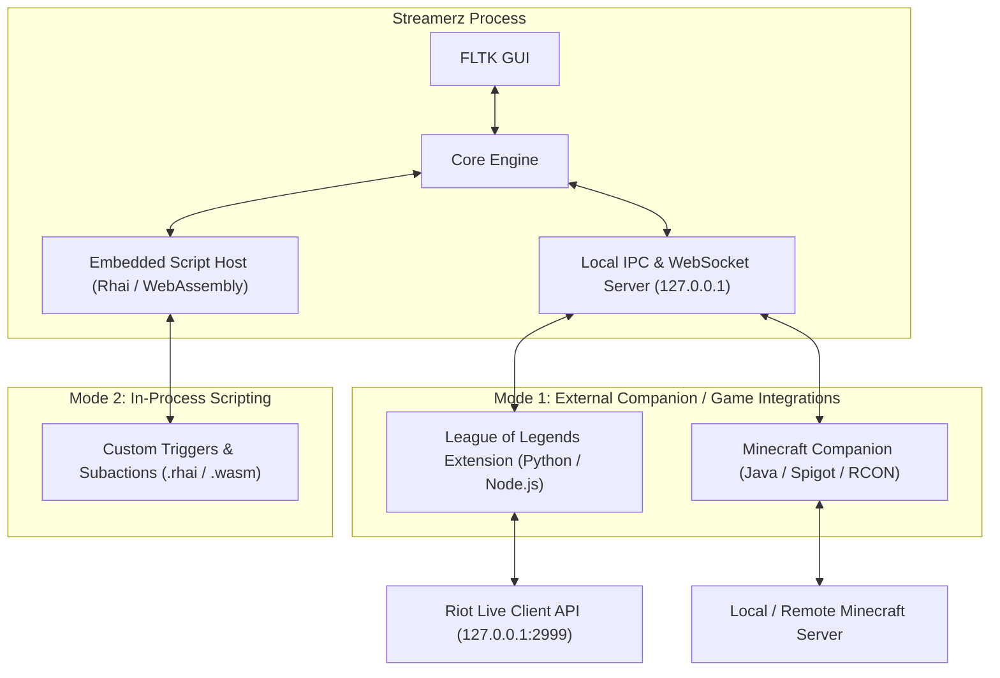

# Streamerz Dynamic Extensions Architecture Plan

Proposal only. This is not the version 1.6.0 implementation plan. `PLAN.md` remains the agreed spec; new runtimes and dependencies require a separate decision.

This document outlines the architecture, design, and roadmap for a revamped, developer-friendly dynamic extension system for Streamerz.

---

## 1. Goals & Principles

1. **Zero Developer Friction:**
   - Any developer should be able to create an extension in Python, JavaScript/Node.js, C#, Rust, or Go without needing to understand raw WebAssembly pointers, memory layouts (`ptr << 32 | len`), or specialized build targets.
2. **Cheap to Run (Minimal RAM & CPU):**
   - In-process extensions should not leak memory or require heavy VMs.
   - External game/companion integrations should run outside Streamerz's process, communicating via lightweight IPC so Streamerz remains lean.
3. **Extensibility Across All Core Primitives:**
   - Extensions must be able to contribute:
     - **Custom Actions / Subactions** (e.g., "Get Champion KDA", "Send Minecraft Title")
     - **Custom Triggers / Events** (e.g., "Player Died", "Dragon Slain", "Server Empty")
     - **Custom Integrations & Servers** (e.g., Riot Live Client API, Minecraft RCON / Spigot bridge)
     - **Custom Settings UI** (auto-rendered fields in the Settings/Plugins tab)
4. **Isolation & Safety:**
   - If an external game integration crashes or freezes, Streamerz must remain completely responsive and unaffected.

---

## 2. Extension Architecture

Extensions can run in one of two modes depending on developer needs:



### Mode 1: External Process / Companion (Recommended for Games)
- **Best for:** League of Legends, Minecraft, OBS plugins, hardware bridges, Discord bots.
- **How it works:**
  - The extension is a standalone folder placed in `extensions/<id>/`.
  - It contains an `extension.json` manifest and an optional runner script or binary (`run.py`, `index.js`, or native executable).
  - Streamerz launches the runner (or connects to its port).
  - The extension communicates with Streamerz over the existing local WebSocket/REST API (`ws://127.0.0.1:8080`).
- **Cost to Streamerz:** \$0 server cost, 0 memory pressure in the main GUI process.

### Mode 2: In-Process Scripting (Rhai / High-Level WASM)
- **Best for:** Custom math formulas, simple webhooks, lightweight chat commands.
- **How it works:**
  - Written in [Rhai](https://github.com/rhaiscript/rhai) (safe, embeddable Rust scripting) or compiled to WASM via a clean `streamerz-sdk` macro that hides all raw memory pointers.

---

## 3. The Extension Manifest (`extension.json`)

Every extension declares its capabilities declaratively:

```json
{
  "id": "league-client",
  "name": "League of Legends Live Integration",
  "version": "1.0.0",
  "author": "Community",
  "description": "Reads local game state from Riot's Live Client API to provide chat commands and automated triggers.",
  "settings": [
    {
      "key": "poll_interval_ms",
      "label": "Game Poll Interval (ms)",
      "kind": "number",
      "default": 1000
    },
    {
      "key": "enable_elo_command",
      "label": "Enable !elo chat command",
      "kind": "bool",
      "default": true
    }
  ],
  "triggers": [
    {
      "id": "game_start",
      "name": "LoL: Game Started",
      "description": "Fires when the champion spawns on the Rift."
    },
    {
      "id": "player_kill",
      "name": "LoL: Champion Kill",
      "description": "Fires when the streamer scores a kill or assist.",
      "arguments": ["victim", "kills", "streak"]
    },
    {
      "id": "player_death",
      "name": "LoL: Streamer Died",
      "description": "Fires when the streamer's champion dies.",
      "arguments": ["killer"]
    }
  ],
  "subactions": [
    {
      "id": "get_stats",
      "name": "LoL: Get Active Game Stats",
      "description": "Fetches current kills, deaths, cs, and gold into variables.",
      "fields": [
        { "key": "variablePrefix", "label": "Variable Prefix", "kind": "text", "default": "lol" }
      ]
    }
  ]
}
```

---

## 4. Example Integrations

### Example A: League of Legends Extension
- **External API:** Riot Client exposes `https://127.0.0.1:2999/liveclientdata/allgamedata` locally on the player's PC when a game is running.
- **Extension Behavior:**
  1. Polls `127.0.0.1:2999` every 1 second.
  2. When match starts, sends `{"type": "trigger", "id": "game_start"}` to Streamerz.
  3. Listens for chat command `!elo`: looks up player tier via spectator/summoner API, returns `{"type": "chat", "message": "Currently Emerald II - 64 LP"}`.
  4. Streamerz executes configured actions (e.g., switches OBS scene on match start, plays sound on death).

### Example B: Minecraft Companion Plugin
- **External System:** Spigot / Paper / Fabric Minecraft server.
- **Extension Behavior:**
  1. A small Java `.jar` or Python RCON script connects to Streamerz local WebSocket.
  2. When a viewer subscribes or donates, Streamerz sends an event to the Minecraft plugin.
  3. The plugin spawns an in-game mob or gives items: `/give @p diamond 5`.
  4. When the player dies in-game, the plugin notifies Streamerz, triggering an OBS death counter action.

---

## 5. Developer Experience & Tooling

To help developers build extensions without reading extensive docs:

1. **In-App "Extensions Hub" in Streamerz:**
   - Under the Extensions / Plugins tab, add:
     - **"New Extension" button:** Scaffolds a folder with a ready-to-run `extension.json` and starter script.
     - **"Open Docs" button:** Displays the event payload reference and API schemas.
2. **Standard JSON-RPC over WebSockets:**
   - Any programming language with a WebSocket library can interact with Streamerz.
3. **No Centralized Server Cost:**
   - Extensions run locally on the streamer's computer.
   - Streamerz does not host API servers, proxy requests, or pay cloud costs.

---

## 6. Implementation Roadmap

- [ ] **Phase 1: Dynamic Form & Manifest Reader:**
  Update the UI to read custom `extension.json` manifests and dynamically render action pickers and form fields without recompiling Streamerz.
- [ ] **Phase 2: Bidirectional WebSocket Extension Bridge:**
  Allow local background processes to register triggers and subactions dynamically over WebSocket RPC.
- [ ] **Phase 3: Community Templates Repository:**
  Provide starter templates for Python, Node.js, and Rhai.
